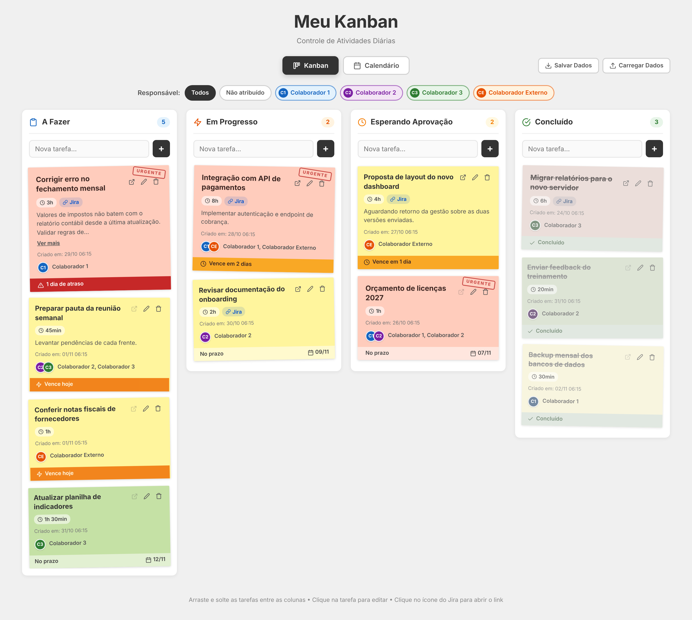
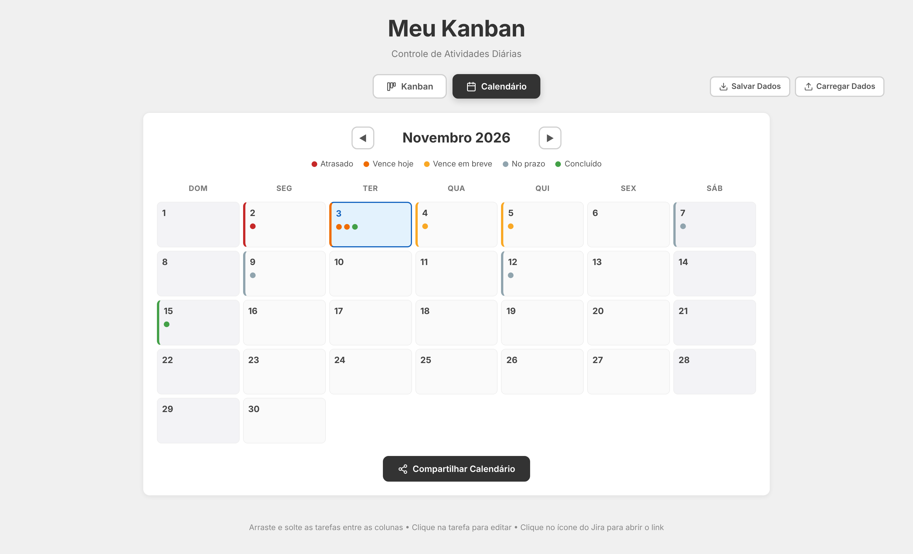
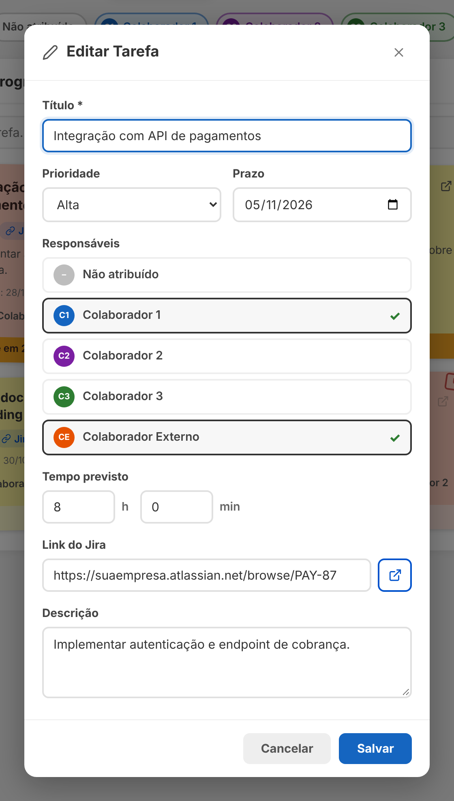
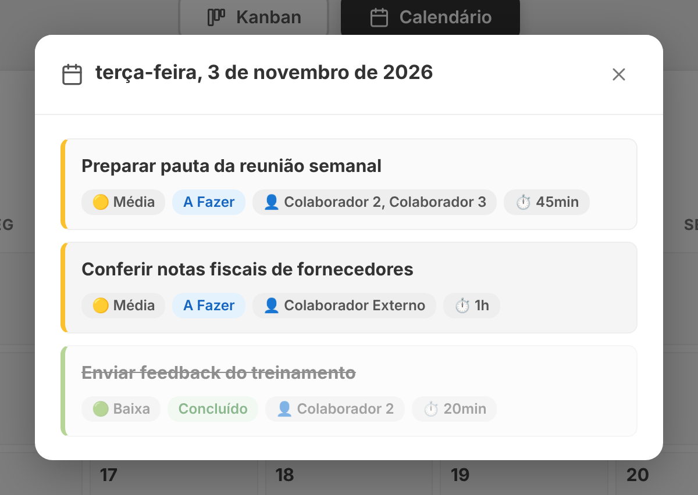
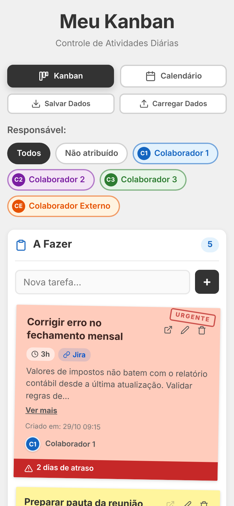

# 📋 My Kanban — Daily Activity Tracker (Meu Kanban)

[🇧🇷 Português](README.md) | 🇺🇸 English

A personal Kanban board to track a team's daily activities, built with **plain HTML, CSS and JavaScript**: no frameworks, no libraries, no build step and no internet needed. Just open `index.html` in your browser.

Tasks show up as **sticky notes** colored by priority, can be **dragged between columns** and come with a **calendar tab** showing deadline status. Everything is saved automatically in the browser (`localStorage`) and can be exported/imported as JSON.

> ℹ️ The app interface is in Brazilian Portuguese.

| Kanban board | Calendar |
|---|---|
|  |  |
| **Editing a task** | **Tasks of the day** |
|  |  |

<p align="center"></p>

---

## ✨ Features

### Kanban board
- **4 columns:** To Do · In Progress · Awaiting Approval · Done, each with a task counter.
- **Quick add:** type in the "Nova tarefa..." (new task) field of any column and press **Enter** or click **+**.
- **Native drag & drop** (HTML5) to move tasks between columns.
- **Automatic ordering:** tasks with a deadline first (nearest on top); the rest by creation date, newest first.

### Sticky notes
- **Color by priority:** 🟥 High · 🟨 Medium · 🟩 Low, with a slight random tilt for a paper look.
- **"URGENT" stamp** on high-priority tasks not yet done.
- **Badges** for estimated time (e.g. `2h 30min`) and Jira link.
- **Description** with "Show more / Show less" when it exceeds 100 characters.
- **Assignees** with colored avatars and initials.
- **Deadline bar** at the bottom of the card:

| Status | Look |
|---|---|
| Overdue | 🔴 red — "N day(s) late" |
| Due today | 🟠 pulsing orange — "Due today" |
| Due within 3 days | 🟡 yellow — "Due in N day(s)" |
| Future deadline | neutral — "On time" + date |
| No deadline | neutral — "No deadline" |
| Done | 🟢 green — "Done" (card struck through and faded) |

### Editing tasks
Click the card (or the pencil icon) to open a modal with: title (required), priority, deadline, **multiple assignees**, estimated time (hours/minutes), Jira link (with URL validation and an open button) and description. The modal closes with **X**, the **ESC** key or by clicking outside it.

### Filter by assignee
Buttons at the top of the board: **All**, **Unassigned** and one for each team member. The filter stays active while moving tasks.

### Calendar
- Month navigation (◀ ▶) with **today highlighted** and weekends set apart.
- Each day shows up to **3 status dots** ("+N" if there are more) and takes the color of its **most urgent** task: Overdue › Due today › Due soon › On time; it turns green when all are done.
- Click a day to see its tasks (pending first, then by priority), with column, assignees, estimated time and Jira link.
- **Share Calendar:** downloads a **standalone** `calendario-dd-mm-aaaa.html` file (embedded CSS) with the month grid and the task table, ready to send to people who don't use the app.

### Data backup
- **Save Data:** exports all tasks to `kanban-dd-mm-aaaa.json`.
- **Load Data:** imports an exported JSON, shows how many tasks exist now and how many come from the file, and asks for confirmation before **replacing everything**.

---

## 🚀 Getting started

1. Download or clone the repository:
   ```bash
   git clone https://github.com/<your-username>/<repository-name>.git
   ```
2. Open `index.html` in any modern browser (Chrome, Edge, Firefox or Safari).

There is nothing to install. It works offline and can also be published on **GitHub Pages** (Settings → Pages → branch `main`, root folder).

> Data is saved **in the browser where you use the app**. To take your tasks to another computer or browser, use **Save Data** and then **Load Data** on the target.

---

## 🗂️ Project structure

```
├── index.html   # Page structure, tabs, columns and modals
├── styles.css   # Sticky notes, columns, calendar, modals and responsiveness
├── app.js       # State, rendering, drag & drop, calendar, export and persistence
├── docs/        # Screenshots
└── README.md
```

---

## 🧩 Data model

Each task is saved in `localStorage` (key `kanban-tasks`) in this format:

```json
{
  "id": 1762210000000,
  "title": "Revisar relatório semanal",
  "column": "progress",
  "priority": "high",
  "deadline": "2026-11-05",
  "estimatedTime": { "hours": 2, "minutes": 30 },
  "jiraLink": "https://suaempresa.atlassian.net/browse/PROJ-123",
  "description": "Conferir os números antes da reunião.",
  "assignees": ["colaborador-1", "colaborador-externo"],
  "createdAt": "2026-11-03T20:44:00.000Z"
}
```

| Field | Values |
|---|---|
| `column` | `todo`, `progress`, `approval`, `done` |
| `priority` | `low`, `medium`, `high` |
| `deadline` | `YYYY-MM-DD` or empty |
| `assignees` | keys from `TEAM_MEMBERS` (empty list = unassigned) |

The exported file wraps the list like this: `{ "version", "exportDate", "kanbanTasks": [...] }`.

---

## 👥 Customizing the team

Assignees live in the `TEAM_MEMBERS` constant at the top of `app.js`:

```js
const TEAM_MEMBERS = {
    'colaborador-1': { name: 'Colaborador 1', initials: 'C1', color: '#1565c0', bg: '#e3f2fd' },
    'colaborador-2': { name: 'Colaborador 2', initials: 'C2', color: '#7b1fa2', bg: '#f3e5f5' },
    'colaborador-3': { name: 'Colaborador 3', initials: 'C3', color: '#2e7d32', bg: '#e8f5e9' },
    'colaborador-externo': { name: 'Colaborador Externo', initials: 'CE', color: '#e65100', bg: '#fff3e0' }
};
```

Add, remove or rename entries; the filter, the edit modal and the calendar update by themselves. `color` is the avatar's main color and `bg` is the light background of the filter button.

> If you remove a member's key, tasks assigned to them will show as "Unassigned".

---

## 🛠️ Tech stack and technical decisions

- **HTML5, CSS3 and ES6+ JavaScript**, with no dependencies or CDN.
- Native HTML5 **Drag and Drop API**.
- **localStorage** for persistence, with automatic migration of older data formats.
- **Blob + `URL.createObjectURL`** to generate the JSON and calendar downloads.
- **FileReader** to import the backup.
- **Inline SVG icons** in Feather style (no image files).
- **Security:** all user-typed text goes through `escapeHtml()` before reaching the screen, and Jira links are validated with `new URL()`.
- **Responsive:** on screens up to 768px the columns take the full width and the calendar is compacted.

---

## 🤖 Built with AI

A portfolio project created from a detailed specification (a structured prompt with role, functional and visual requirements and acceptance criteria) and implemented with **Claude (Anthropic)**, with automated verification in a headless browser.
