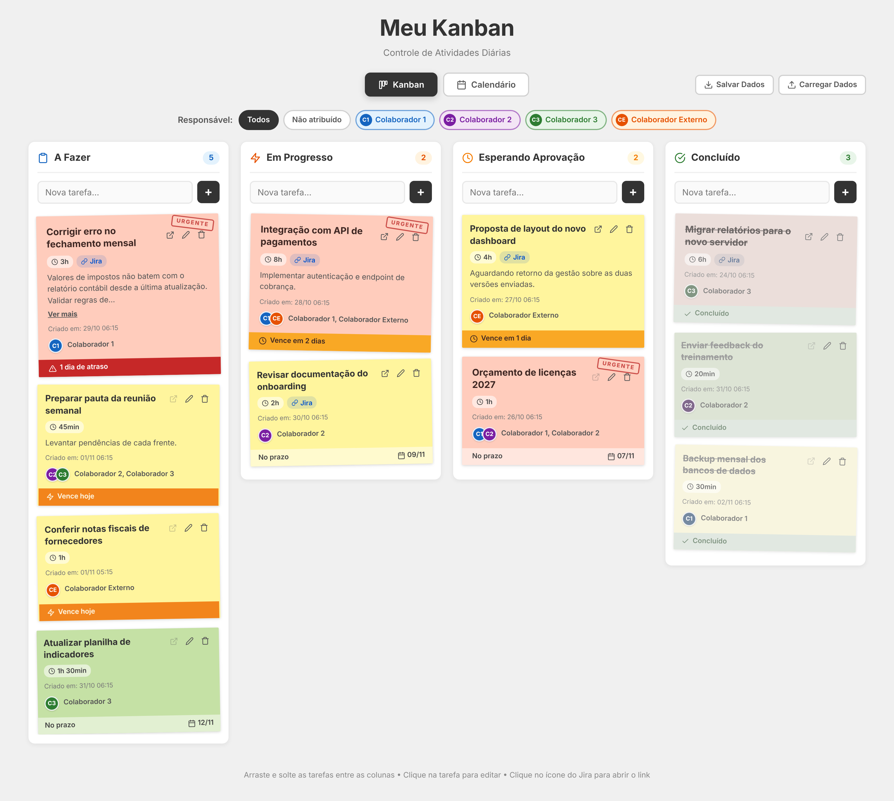
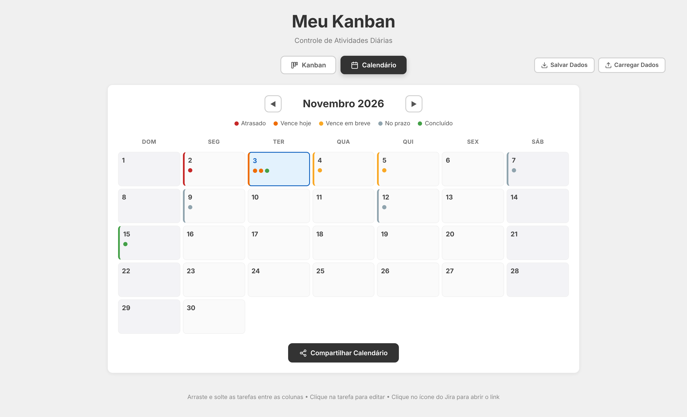
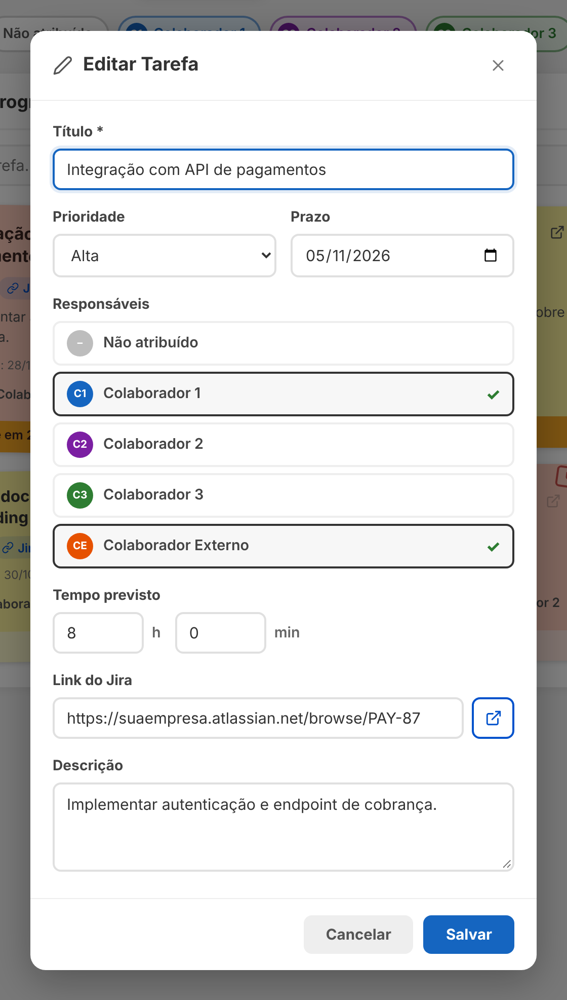
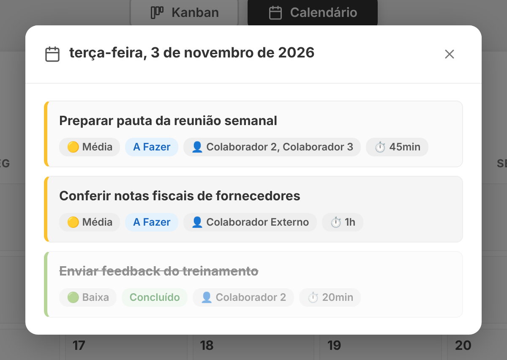
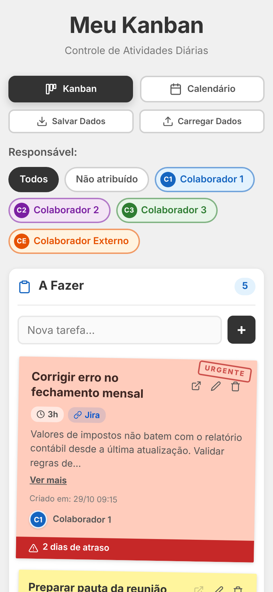

# 📋 Meu Kanban — Controle de Atividades Diárias

🇧🇷 Português | [🇺🇸 English](README.en.md)

Kanban pessoal para acompanhar as atividades diárias de uma equipe, feito com **HTML, CSS e JavaScript puros**: sem frameworks, sem bibliotecas, sem build e sem internet. Basta abrir o `index.html` no navegador.

As tarefas aparecem como **post-its** coloridos por prioridade, podem ser **arrastadas entre colunas** e são acompanhadas por uma **aba de calendário** com o status dos prazos. Tudo fica salvo automaticamente no navegador (`localStorage`) e pode ser exportado/importado em JSON.

| Quadro Kanban | Calendário |
|---|---|
|  |  |
| **Editando uma tarefa** | **Tarefas do dia** |
|  |  |

<p align="center"></p>

---

## ✨ Funcionalidades

### Quadro Kanban
- **4 colunas:** A Fazer · Em Progresso · Esperando Aprovação · Concluído, cada uma com contador de tarefas.
- **Criação rápida:** digite no campo "Nova tarefa..." de qualquer coluna e tecle **Enter** ou clique em **+**.
- **Drag & drop nativo** (HTML5) para mover tarefas entre colunas.
- **Ordenação automática:** tarefas com prazo primeiro (mais próximo no topo); as demais pela data de criação, das mais novas para as mais antigas.

### Post-its
- **Cor por prioridade:** 🟥 Alta · 🟨 Média · 🟩 Baixa, com leve rotação aleatória para o efeito de papel.
- **Selo "URGENTE"** nas tarefas de prioridade alta ainda não concluídas.
- **Badges** de tempo previsto (ex.: `2h 30min`) e de link do Jira.
- **Descrição** com "Ver mais / Ver menos" quando passa de 100 caracteres.
- **Responsáveis** com avatares coloridos e iniciais.
- **Barra de prazo** no rodapé do card:

| Situação | Aparência |
|---|---|
| Atrasada | 🔴 vermelho — "N dia(s) de atraso" |
| Vence hoje | 🟠 laranja pulsando — "Vence hoje" |
| Vence em até 3 dias | 🟡 amarelo — "Vence em N dia(s)" |
| Prazo futuro | neutro — "No prazo" + data |
| Sem prazo | neutro — "Sem prazo" |
| Concluída | 🟢 verde — "Concluído" (card riscado e apagado) |

### Edição de tarefas
Clique no card (ou no ícone de lápis) para abrir o modal com: título (obrigatório), prioridade, prazo, **múltiplos responsáveis**, tempo previsto (horas/minutos), link do Jira (com validação de URL e botão para abrir) e descrição. O modal fecha pelo **X**, pela tecla **ESC** ou clicando fora dele.

### Filtro por responsável
Botões no topo do quadro: **Todos**, **Não atribuído** e um para cada membro da equipe. O filtro continua ativo ao mover tarefas.

### Calendário
- Navegação entre meses (◀ ▶) com o **dia atual destacado** e fins de semana diferenciados.
- Cada dia mostra até **3 bolinhas** de status (e "+N" se houver mais) e assume a cor da tarefa **mais urgente**: Atrasado › Vence hoje › Vence em breve › No prazo; fica verde quando todas estão concluídas.
- Clique em um dia para ver suas tarefas (pendentes primeiro, depois por prioridade), com coluna, responsáveis, tempo previsto e link do Jira.
- **Compartilhar Calendário:** baixa um arquivo `calendario-dd-mm-aaaa.html` **autônomo** (CSS embutido) com a grade do mês e a tabela de tarefas, pronto para enviar a quem não usa o app.

### Backup dos dados
- **Salvar Dados:** exporta todas as tarefas para `kanban-dd-mm-aaaa.json`.
- **Carregar Dados:** importa um JSON exportado, mostra quantas tarefas existem hoje e quantas virão do arquivo e pede confirmação antes de **substituir tudo**.

---

## 🚀 Como usar

1. Baixe ou clone o repositório:
   ```bash
   git clone https://github.com/<seu-usuario>/<nome-do-repositorio>.git
   ```
2. Abra o arquivo `index.html` em qualquer navegador moderno (Chrome, Edge, Firefox ou Safari).

Não há nada para instalar. Funciona offline e também pode ser publicado no **GitHub Pages** (Settings → Pages → branch `main`, pasta raiz).

> Os dados ficam salvos **no navegador em que você usa o app**. Para levar as tarefas para outro computador ou navegador, use **Salvar Dados** e depois **Carregar Dados** no destino.

---

## 🗂️ Estrutura do projeto

```
├── index.html   # Estrutura da página, abas, colunas e modais
├── styles.css   # Visual dos post-its, colunas, calendário, modais e responsividade
├── app.js       # Estado, renderização, drag & drop, calendário, exportação e persistência
├── docs/        # Capturas de tela
└── README.md
```

---

## 🧩 Modelo de dados

Cada tarefa é salva no `localStorage` (chave `kanban-tasks`) neste formato:

```json
{
  "id": 1762210000000,
  "title": "Revisar relatório semanal",
  "column": "progress",
  "priority": "high",
  "deadline": "2026-11-05",
  "estimatedTime": { "hours": 2, "minutes": 30 },
  "jiraLink": "https://suaempresa.atlassian.net/browse/PROJ-123",
  "description": "Conferir os números antes da reunião.",
  "assignees": ["colaborador-1", "colaborador-externo"],
  "createdAt": "2026-11-03T20:44:00.000Z"
}
```

| Campo | Valores |
|---|---|
| `column` | `todo`, `progress`, `approval`, `done` |
| `priority` | `low`, `medium`, `high` |
| `deadline` | `YYYY-MM-DD` ou vazio |
| `assignees` | chaves de `TEAM_MEMBERS` (lista vazia = não atribuído) |

O arquivo exportado envolve a lista assim: `{ "version", "exportDate", "kanbanTasks": [...] }`.

---

## 👥 Personalizando a equipe

Os responsáveis ficam na constante `TEAM_MEMBERS`, no início do `app.js`:

```js
const TEAM_MEMBERS = {
    'colaborador-1': { name: 'Colaborador 1', initials: 'C1', color: '#1565c0', bg: '#e3f2fd' },
    'colaborador-2': { name: 'Colaborador 2', initials: 'C2', color: '#7b1fa2', bg: '#f3e5f5' },
    'colaborador-3': { name: 'Colaborador 3', initials: 'C3', color: '#2e7d32', bg: '#e8f5e9' },
    'colaborador-externo': { name: 'Colaborador Externo', initials: 'CE', color: '#e65100', bg: '#fff3e0' }
};
```

Adicione, remova ou renomeie entradas; o filtro, o modal de edição e o calendário se atualizam sozinhos. `color` é a cor principal do avatar e `bg` é o fundo claro do botão de filtro.

> Se você remover a chave de um membro, as tarefas atribuídas a ele passam a aparecer como "Não atribuído".

---

## 🛠️ Tecnologias e decisões técnicas

- **HTML5, CSS3 e JavaScript ES6+**, sem dependências nem CDN.
- **Drag and Drop API** nativa do HTML5.
- **localStorage** para persistência, com migração automática de formatos antigos de dados.
- **Blob + `URL.createObjectURL`** para gerar os downloads de JSON e do calendário.
- **FileReader** para importar o backup.
- **Ícones SVG inline** no estilo Feather (sem arquivos de imagem).
- **Segurança:** todo texto digitado pelo usuário passa por `escapeHtml()` antes de ir para a tela, e links do Jira são validados com `new URL()`.
- **Responsivo:** em telas de até 768px as colunas ocupam a largura total e o calendário é compactado.

---

## 🤖 Desenvolvido com IA

Projeto de portfólio criado a partir de uma especificação detalhada (prompt estruturado com papel, requisitos funcionais e visuais e critérios de aceite) e implementado com o **Claude (Anthropic)**, com verificação automatizada em navegador headless.
